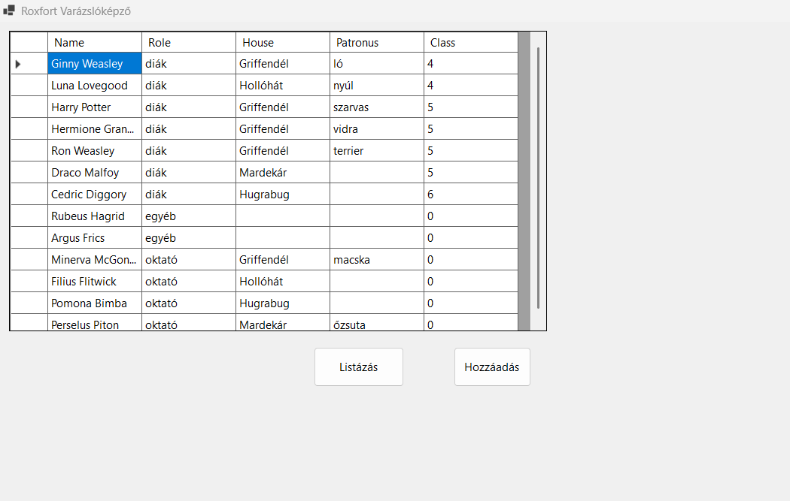
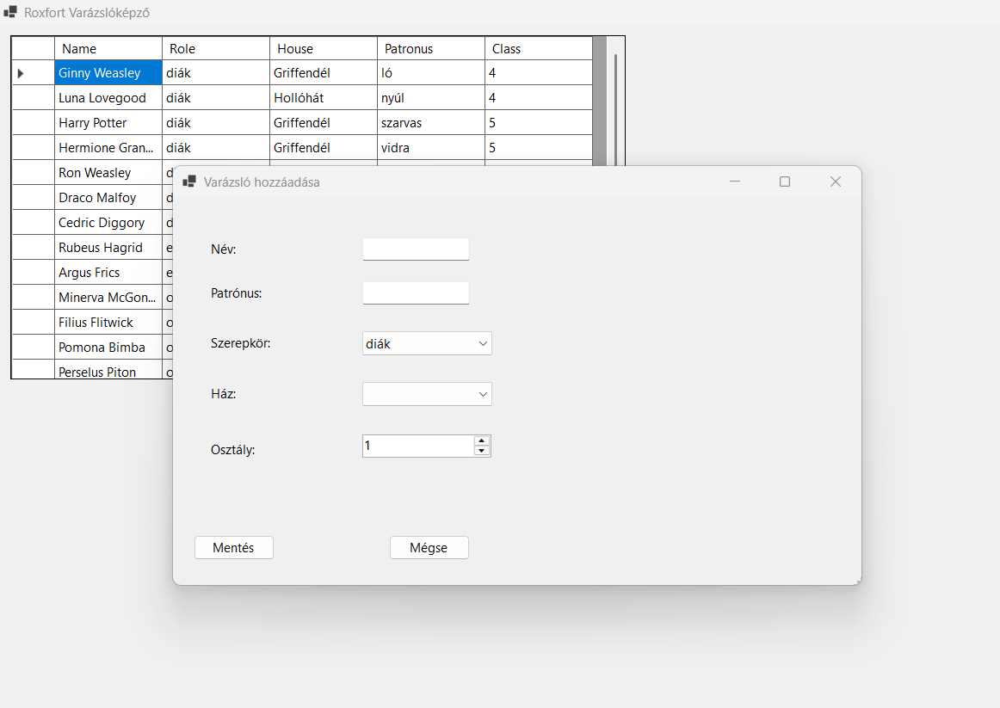
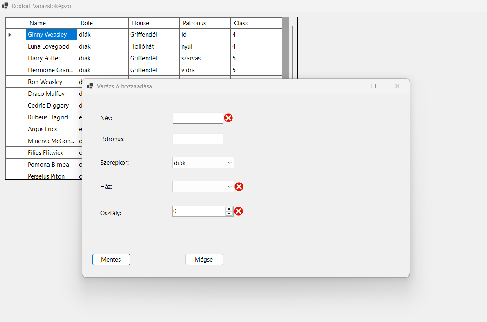

# Roxfort Varázslóképző – nyilvántartó rendszer

Egy C# / Windows Forms asztali alkalmazás egy kitalált varázslóiskola, a **Roxfort** diákjainak és személyzetének nyilvántartására. A projekt kicsi, de egy tipikus, rétegzett .NET asztali alkalmazás minden fontos elemét bemutatja: **Entity Framework Core Code-First** adatelérést, **SQLite** adatbázist, **Dependency Injectiont** a .NET **Generic Host**-tal, **LINQ**-alapú lekérdezést és űrlap-validációt.

## Képernyőképek

| Főablak | Új varázsló felvétele | Validációs hiba |
|---|---|---|
|  |  |  |

## Tartalom

- [A projekt háttere](#a-projekt-háttere)
- [Funkciók](#funkciók)
- [Használat](#használat)
- [Adatmodell és szabályok](#adatmodell-és-szabályok)
- [Technológiák](#technológiák)
- [A projekt felépítése](#a-projekt-felépítése)
- [Tervezési döntések](#tervezési-döntések)
- [Futtatás](#futtatás)
- [Tesztek](#tesztek)
- [Hibaelhárítás](#hibaelhárítás)
- [Továbbfejlesztési ötletek](#továbbfejlesztési-ötletek)

## A projekt háttere

A Roxfortnak egyszerű eszközre van szüksége, amellyel nyilvántartható, kik tanulnak és dolgoznak az iskolában: milyen szerepkörben, melyik házban, hányadik osztályban, és milyen alakú a patrónusuk. Az alkalmazás ezt oldja meg: egy táblázatban mutatja az összes varázslót, és külön ablakban, ellenőrzött módon lehet új varázslót felvenni.

A projekt egyben jó példa arra, hogyan lehet egy kis WinForms alkalmazást úgy felépíteni, hogy az adatelérés, a megjelenítés és a függőségek kezelése egymástól elkülönüljön.

## Funkciók

### Varázslók listázása

- Indításkor az alkalmazás beolvassa az adatbázis összes rekordját, és megjeleníti egy táblázatban.
- A **Listázás** gomb bármikor újra lekérdezi az adatokat az adatbázisból.
- A sorok rendezése: **szerepkör** (ABC) → **osztály** (növekvő) → **ház** (ABC).
- Az azonosító (`ID`) nem látszik a táblázatban.
- A táblázat csak olvasható.

### Új varázsló felvétele

- A **Hozzáadás** gomb egy külön párbeszédablakot nyit.
- A **Mentés** ellenőrzi az adatokat. Hiba esetén a hibás mező mellett piros jelzés és üzenet jelenik meg, és az adat nem kerül az adatbázisba.
- Sikeres mentés után az ablak bezárul, és a főablak automatikusan frissíti a listát.
- A **Mégse** gomb bezárja az ablakot mentés nélkül.

## Használat

1. Indítsd el az alkalmazást. A főablakban megjelennek az adatbázisban lévő varázslók.
2. Kattints a **Hozzáadás** gombra.
3. Add meg a nevet, és válassz szerepkört (`diák`, `oktató` vagy `egyéb`). Alapértelmezetten a `diák` van kiválasztva.
4. Diáknál válassz házat és osztályt (1–7). Más szerepkörnél a ház elhagyható, az osztály pedig nem számít.
5. A patrónus mindig opcionális.
6. Kattints a **Mentés** gombra. Az új varázsló megjelenik a listában a rendezési szabály szerinti helyén.

## Adatmodell és szabályok

### `Wizard`

| Mező | Típus | Leírás |
|---|---|---|
| `ID` | int | Egyedi azonosító (az adatbázis generálja) |
| `Name` | string | A varázsló neve |
| `Role` | string | `diák`, `oktató` vagy `egyéb` |
| `House` | string | `Griffendél`, `Mardekár`, `Hollóhát` vagy `Hugrabug` |
| `Patronus` | string | A patrónus alakja (opcionális) |
| `Class` | int | Diákok osztálya (1–7), minden más szerepkörnél 0 |

### Az űrlap szabályai

| Mező | Vezérlő | Szabály |
|---|---|---|
| Név | `TextBox` | Kötelező. A csak szóközökből álló név érvénytelen, a vezető és záró szóközök levágódnak. |
| Szerepkör | `ComboBox` (DropDownList) | Kötelező: `diák` / `oktató` / `egyéb`. |
| Ház | `ComboBox` (DropDownList) | **Diáknál kötelező**, másoknál elhagyható (üresen mentődik). |
| Patrónus | `TextBox` | Opcionális. Üresen hagyva `NULL` kerül az adatbázisba. |
| Osztály | `NumericUpDown` | **Diáknál 1–7 között kötelező.** Csak diáknál mentődik, minden más szerepkörnél 0. |

## Technológiák

- C# és Windows Forms, **.NET 10** (Windows)
- **Entity Framework Core 10**, Code-First megközelítéssel, migrációkkal
- **SQLite** adatbázis
- **Dependency Injection** a .NET Generic Hosttal (`Microsoft.Extensions.Hosting`)
- **LINQ** a lekérdezéshez, a rendezéshez és az azonosító elhagyásához
- **xUnit** tesztek (`Evaluation` projekt)

## A projekt felépítése

```text
.
├── Hogwarts.slnx                    # solution
├── Hogwarts/                        # az alkalmazás
│   ├── Context/WizardContext.cs     # EF Core DbContext
│   ├── Model/Wizard.cs              # az adatmodell
│   ├── Migrations/                  # EF Core migrációk
│   ├── View/
│   │   ├── StartUp.*                # főablak: lista + Listázás / Hozzáadás gomb
│   │   └── Add.*                    # új varázsló felvétele (párbeszédablak)
│   ├── DB/wizards.db                # SQLite adatbázis
│   └── Program.cs                   # belépési pont, Generic Host + DI konfiguráció
├── Evaluation/                      # xUnit tesztek
└── docs/screenshots/                # a README képernyőképei
```

## Tervezési döntések

### Dependency Injection a Generic Hosttal

A szolgáltatások regisztrációja egy helyen történik, a `Program.cs`-ben, a .NET Generic Host segítségével:

```csharp
var host = Host.CreateDefaultBuilder()
    .ConfigureServices((context, services) =>
    {
        services.AddSingleton<WizardContext>();
        services.AddTransient<StartUp>();
        services.AddTransient<Add>();
    })
    .Build();

using var serviceScope = host.Services.CreateScope();
var startForm = serviceScope.ServiceProvider.GetRequiredService<StartUp>();

Application.Run(startForm);
```

- A Generic Host ugyanaz az infrastruktúra, amit az ASP.NET Core és a worker service-ek is használnak. Ha később konfigurációra (`appsettings.json`) vagy naplózásra lenne szükség, az alkalmazás ezt külön átalakítás nélkül megkapja.
- A **`WizardContext` singleton**, így a főablak és az Add ablak ugyanazt az adatbázis-kapcsolatot használja. Ha az Add ablak ment, a főablak ugyanabban a contextben látja az új rekordot.
- A két form **transient**, tehát minden megnyitáskor új példány készül. Az Add ablak így mindig üres mezőkkel nyílik meg, és bezárás után eldobható.
- Mindkét form konstruktora `IServiceProvider` paramétert kap, és ebből kéri el, amire szüksége van. A `StartUp` így az Add formot a konténerből éri el, nem `new Add()`-del hozza létre:

```csharp
private void AddWizard(object sender, EventArgs e)
{
    using var window = serviceProvider.GetRequiredService<Add>();
    window.ShowDialog();

    if (window.DialogResult == DialogResult.OK)
        UpdateGridView();
}
```

A lista csak akkor frissül, ha az ablak `OK` eredménnyel zárult, vagyis ténylegesen történt mentés.

### LINQ: rendezés és az `ID` elhagyása `Select` projekcióval

```csharp
wizardGridView.DataSource = context.Wizards
    .OrderBy(w => w.Role)
    .ThenBy(w => w.Class)
    .ThenBy(w => w.House)
    .Select(w => new { w.Name, w.Role, w.House, w.Patronus, w.Class })
    .ToList();
```

- Az `OrderBy` és a `ThenBy` láncolása adja a többszintű rendezést, és az egész SQL-ben fut le az adatbázison.
- A `Select` **névtelen típusba vetít**, amelyben nincs `ID`. Ezért az oszlop a táblázatban sem keletkezik. Ez tisztább megoldás, mint az oszlop elrejtése a `DataGridView`-ban, mert a felületre eleve csak az kerül, amit meg akarunk jeleníteni.

### Validáció `ErrorProvider`-rel

A `Save` eseménykezelő először törli a korábbi hibákat, ellenőrzi az összes szabályt, és csak akkor ment, ha mindegyik teljesül:

```csharp
errorProvider.Clear();

string name = nameTextBox.Text.Trim();
string? role = roleComboBox.SelectedItem?.ToString();
string? house = houseComboBox.SelectedItem?.ToString();
int wizardClass = (int)classUpDown.Value;
bool isValid = true;

if (name.Length == 0)
{
    errorProvider.SetError(nameTextBox, "A név megadása kötelező!");
    isValid = false;
}

if (role == "diák")
{
    if (house == null)
    {
        errorProvider.SetError(houseComboBox, "Diáknál a ház kötelező!");
        isValid = false;
    }

    if (wizardClass < 1 || wizardClass > 7)
    {
        errorProvider.SetError(classUpDown, "Az osztály 1 és 7 között legyen!");
        isValid = false;
    }
}

if (!isValid)
    return;
```

- Az ellenőrzés **nem áll meg az első hibánál**: az összes hibás mező egyszerre jelzést kap, így a felhasználónak nem kell többször próbálkoznia.
- Az osztály szabályát a mentés pillanatában érvényesítjük: csak diáknál olvassuk ki a `NumericUpDown` értékét, minden mást 0-ra állítunk. Az üres patrónus `NULL`-ként mentődik, nem üres szövegként:

```csharp
Patronus = patronus.Length > 0 ? patronus : null,
Class = role == "diák" ? wizardClass : 0
```

### Adatbázis és migrációk

A séma kódból épül (**Code-First**): a `Wizard` osztályból készül az `InitialCreate` migráció, amely létrehozza a `Wizards` táblát. A `WizardContext` az SQLite útvonalát (`../../../DB/wizards.db`) a futtatási könyvtárhoz képest relatívan adja meg. A második, `DbContextOptions`-t váró konstruktor azért van, hogy a context kívülről, például tesztből is konfigurálható legyen.

## Futtatás

### Követelmények

- Windows
- [.NET 10 SDK](https://dotnet.microsoft.com/download)
- Visual Studio, amely támogatja a `.slnx` formátumot és a .NET 10-et (ajánlott)

### Indítás

1. Klónozd a repót, és nyisd meg a `Hogwarts.slnx` fájlt Visual Studióban.
2. Állítsd a **Hogwarts** projektet kezdőprojektnek (jobb klikk → *Set as Startup Project*).
3. Indítsd el az alkalmazást (`F5`).

Az adatbázis útvonala a program futtatási könyvtárához képest relatív, ezért az alkalmazást Visual Studióból, vagy a build kimeneti mappájából (`Hogwarts/bin/Debug/net10.0-windows/`) indítsd. A `dotnet run` a projekt mappájából indul, így ott az útvonal rossz helyre mutat.

### Az adatbázis újragenerálása

A repóban egy kész `Hogwarts/DB/wizards.db` van néhány mintarekorddal. Ha üresen, újra létre akarod hozni, töröld a fájlt, és a Visual Studio **Package Manager Console** ablakában (Tools → NuGet Package Manager), a **Hogwarts** projektet kiválasztva futtasd:

```powershell
Update-Database
```

Ellenőrizd, hogy a `wizards.db` a `Hogwarts/DB/` mappába került-e. Ha máshol keletkezett, másold át oda.

Új migrációt a modell módosítása után így készíthetsz:

```powershell
Add-Migration MigracioNeve
Update-Database
```

## Tesztek

Az `Evaluation` projekt 8 xUnit tesztje a következőket ellenőrzi:

| Teszt | Mit vizsgál |
|---|---|
| Modell | A `Wizard` osztály létezik, a property-k neve és típusa megfelelő |
| DbContext | A `WizardContext` létezik, és van `Wizards` `DbSet`-je |
| Adatbázis | A migráció lefutott, a `wizards.db` létezik a megfelelő helyen |
| Dependency Injection | A formok `IServiceProvider`-en keresztül kapják a függőségeiket |
| Add form – felépítés | A vezérlők léteznek, és megfelelően vannak beállítva |
| Add form – helyes mentés | Kitöltött, érvényes adatokkal a rekord bekerül az adatbázisba, az ablak `OK` eredménnyel zárul |
| Add form – hibás mentés | Hiányzó adatoknál nincs mentés, az `ErrorProvider` hibát jelez |
| Főablak | Betöltéskor megjelennek az adatok, `ID` nélkül, a megadott rendezés szerint |

A UI-t érintő tesztek az `Xunit.StaFact` csomaggal STA szálon futnak, ahogy a WinForms megköveteli. A tesztek a valódi `wizards.db` fájlt használják, ezért futtatás után tesztrekordok maradhatnak benne.

Visual Studióban: *Test → Run All Tests*. Parancssorból a repó gyökeréből:

```powershell
dotnet test .\Evaluation\Evaluation.csproj
```

## Hibaelhárítás

Ha a repót zipként töltöd le, és a build azt írja, hogy egy `.resx` fájlt nem tud feldolgozni a „Mark of the Web" miatt, a repó gyökeréből oldd fel a fájlokat:

```powershell
Get-ChildItem -Path . -Recurse -File | Unblock-File
```

Gitből klónozva ez nem fordul elő.

## Továbbfejlesztési ötletek

- Varázsló szerkesztése és törlése a táblázatból
- Keresés és szűrés név, szerepkör vagy ház szerint
- Export CSV-be
- A validáció kiemelése külön osztályba, hogy külön is tesztelhető legyen
- A `Role` és a `House` értékeinek lecserélése `enum`-ra
- A tesztek átállítása memóriában futó SQLite adatbázisra, hogy ne módosítsák a valódi adatbázist
- Az adatbázis automatikus létrehozása az első indításkor
